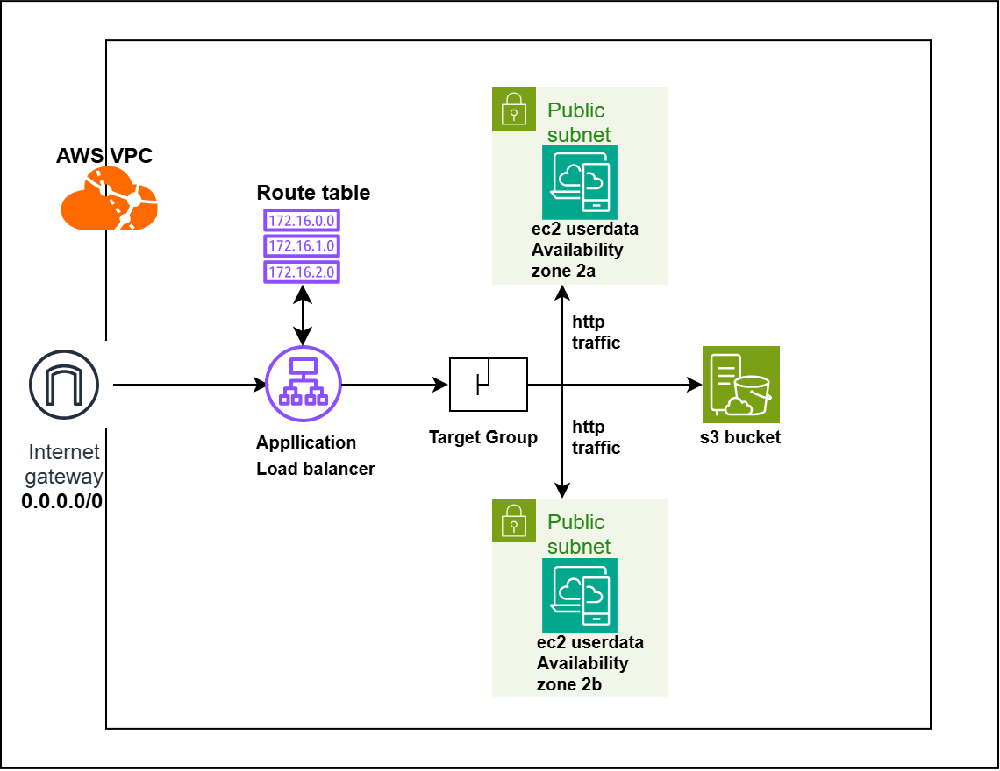

## 📘 Architecture Diagram




# **Creating VPC Using Terraform**

This project demonstrates how to build a complete AWS VPC architecture using Terraform. It includes networking components, security layers, EC2 instances, and an Application Load Balancer — all deployed automatically through Infrastructure as Code (IaC).

---
---
## **📁 Project Structure**

```
backend.tf
│main.tf
│variables.tf
│providers.tf
│userdata.sh
│userdata2.sh
│terraform.tfstate

```
---
## **🧩 Tools Used**

- **Terraform** (Infrastructure as Code)  
- **AWS VPC, Subnets, IGW, Route Tables**  
- **EC2 Instances**  
- **Application Load Balancer**  
- **Security Groups**  
- **User‑data scripts (Bash)**
--- 
## **📌 Project Builds and Deploy**


- A custom **VPC**  
- Two **public subnets** across different Availability Zones  
- An **Internet Gateway**  
- A **Route Table** with a default route to the internet  
- A **Security Group** for ALB and EC2  
- Two **EC2 web servers** with user‑data scripts  
- An **Application Load Balancer (ALB)**  
- A **Target Group** with health checks  
- ALB → EC2 **traffic forwarding**  
- S3 bucket remote backend
---

## **🚀 Executions Steps**
```
terraform init
terraform validate
terraform plan
terraform apply -auto-approve
terraform destroy
```
1. Configure AWS credentials.
2. Create an S3 bucket for remote state storage.
3. Configure the Terraform S3 backend.
4. Run terraform init to initialize the backend.
5. Terraform stores and manages the terraform.tfstate file in S3.
6. Run terraform plan to review infrastructure changes.
7. Run terraform apply to provision AWS resources.Terraform provisions the VPC and networking resources.  
8. Two EC2 instances are launched in separate subnets.  
9. Each EC2 runs a separate user‑data script that installs Apache and serves a custom HTML page.  
10. The ALB distributes traffic across both EC2 instances.  
11. Health checks ensure only healthy instances receive traffic.
12. End with command to destroy.
   

---

## **🌐Screenshots-Access the Application**
Each EC2 instance serves a webpage showing:

- Server name  
- Instance ID  
- Custom message  

The ALB DNS distributes traffic between both servers.
---


---


